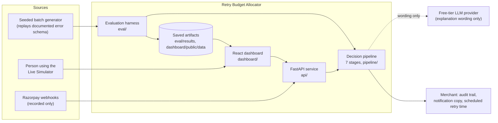
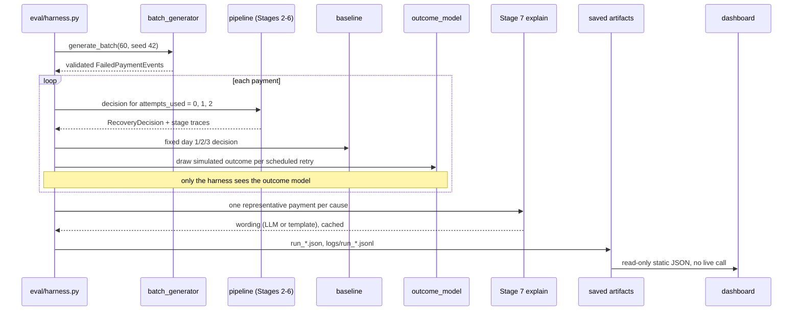
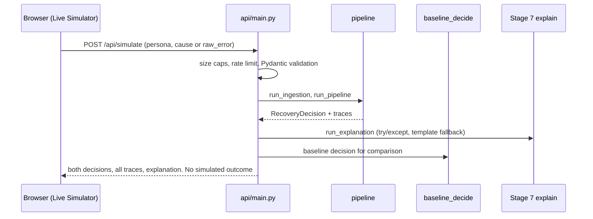
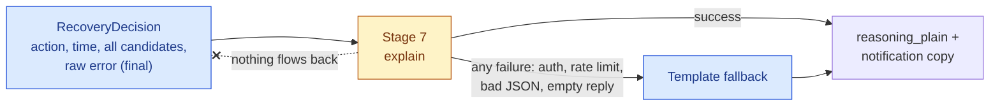
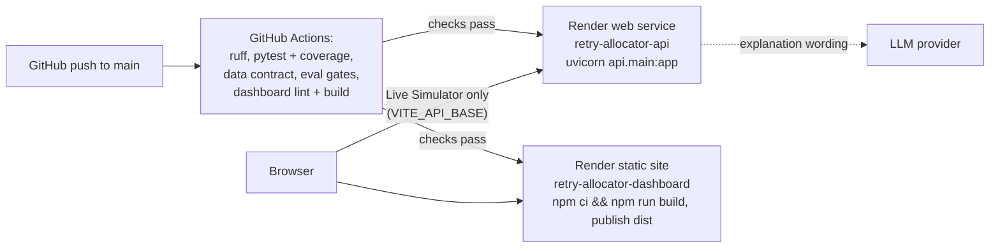
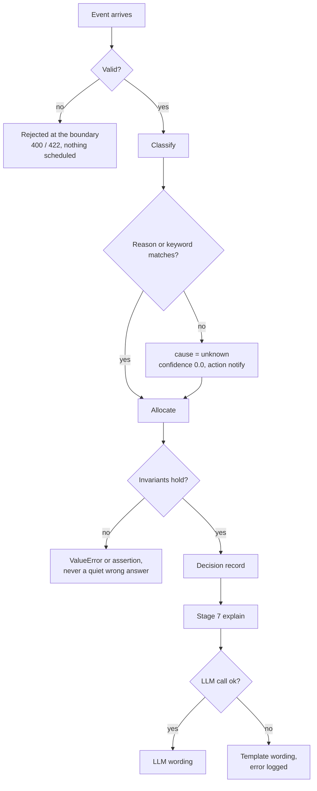

# High-Level Design (HLD)

Detailed High-Level Design of the Retry Budget Allocator: what problem it
solves, how the parts fit together, where AI is and is not used, how it is
deployed and secured, and what happens when things fail.

Related documents: [architecture.md](architecture.md) (pipeline and
compliance diagrams), [LLD.md](LLD.md) (module-level design),
[RESULTS.md](RESULTS.md) (every number and the outcome model),
[errorlog.md](errorlog.md) (real errors and fixes), [prd.md](prd.md) (the
specification; "Sec N" below refers to it).

Contents: [1 Problem](#1-problem) - [2 Goals and non-goals](#2-goals-and-non-goals) -
[3 System context](#3-system-context) - [4 Components](#4-components) -
[5 Data flow](#5-data-flow) - [6 AI versus deterministic](#6-ai-versus-deterministic-boundaries) -
[7 Deployment](#7-deployment) - [8 Security](#8-security) - [9 Scalability](#9-scalability) -
[10 Failure modes](#10-failure-modes-and-degradation) - [11 Trade-offs](#11-trade-offs-and-alternatives-rejected)

## 1. Problem

When a recurring UPI AutoPay debit fails, the merchant has a small,
regulated, non-renewable budget of recovery attempts: one original attempt
and at most three retries per mandate (NPCI cap), never inside a peak window
(10:00-13:00 and 17:00-21:30 IST), and at most one successful debit per token
per billing cycle (PRD Sec 2). Razorpay's controlled server-to-server UPI
AutoPay flow does not auto-retry; it hands the decision to the merchant (PRD
Sec 1, Sec 2). Most merchants answer with a fixed schedule: retry on day 1, 2
and 3 whatever the cause.

That is an allocation problem treated as a calendar problem. A fixed
schedule spends attempts on failures no retry can fix (a revoked or expired
mandate, a debit above the mandate cap), and it ignores timing for the
failures that can be fixed (an insufficient balance is only recoverable once
the account is funded).

The narrow claim this project makes is: cause-classified allocation of a
hard-capped budget with an explicit stop. It does not claim novel retry
spacing (24h/72h/7d is published practice), does not claim to know when a
customer is paid (it infers a window with a confidence score), and does not
claim real-world recovery rates (outcomes are simulated from a declared
model, [RESULTS.md](RESULTS.md) Section 1).

## 2. Goals and non-goals

| Goals | Non-goals |
|---|---|
| Choose one of three interventions per failed payment: notify the customer, retry at a chosen compliant time, or stop early (PRD Sec 3) | Being a scheduler. If every payment collapsed into "retry later" the project would fail its own premise |
| Make the three compliance invariants structural and tested: at most 3 retries, no peak-window scheduling, one successful debit per cycle (PRD Sec 7 step 2) | Bypassing or "gaming" NPCI limits. The system is defence-only |
| Classify the failure cause by deterministic lookup over the Razorpay error object, never by a model | Learning the classifier or the policy from data. There is no real failure data to learn from |
| Keep every scored candidate window, the raw error payload and a trace entry per stage, so a reviewer can verify the mechanism (PRD Sec 6.1) | Showing only conclusions |
| Evaluate honestly: state the outcome model first, sweep its parameters, check multiple seeds, report where the allocator loses (PRD Sec 5) | Reporting a real-world recovery rate. The honest claim is that the allocator spends a scarce budget well under a stated outcome model |
| Degrade gracefully: a model-provider outage changes explanation text only, never a decision (PRD Sec 6.2) | Needing the network to run the batch study, CI or the dashboard |
| Be reproducible offline: seeded generators, frozen outcome model, committed artifacts | Hosting at scale. A small Render deployment exists for the live simulator; there is no production traffic |

## 3. System context

The system sits between a payment event source and the merchant's operations.
In this repository the event source is either a seeded generator (the batch
study) or a person using the dashboard's Live Simulator. A real Razorpay
webhook receiver exists but only records events; it does not feed the
pipeline. Mandate registration against Razorpay's test API is gated behind a
Razorpay Support activation this account does not have
([RESULTS.md](RESULTS.md) Section 8), so no real failed debit has flowed
through the system.

## 4. Components

| Component | Location | Responsibility | Deterministic? |
|---|---|---|---|
| Decision pipeline | `pipeline/` | Seven stages: ingest, classify, priors, funding window, allocate, decision record, explain. Every stage returns its result plus a trace entry | Stages 1-6 yes; Stage 7 optionally uses an LLM |
| Compliance module | `pipeline/compliance.py` | The three invariants as pure predicates, plus the shift-out-of-peak helper. No dependency on the allocator | Yes |
| Evaluation harness | `eval/` | Frozen outcome model, fixed-schedule baseline, seeded batch generator, harness, sensitivity sweep, multi-seed check, economics, policy what-if, explanation eval, data contract | Yes (seeded) |
| API service | `api/` | `POST /api/simulate` (the same pipeline, live), `GET /api/personas`, signed webhook receiver, opt-in Razorpay test-mode client | Yes, except the Stage 7 call |
| Dashboard | `dashboard/` | Static React app: landing page, guided tour, live simulator, story, decision trace, batch results, evals, audit trail, policy what-if | n/a |
| Saved artifacts | `eval/results/*.json`, `dashboard/public/data/*.json` | The only data the dashboard reads by default | n/a |
| Fixtures | `data/fixtures/` | Seven cause fixtures with provenance (documented, provisional, live) and the raw record of every live probe | n/a |
| Build and quality gates | `.github/workflows/`, `scripts/validate.sh` | Tests, eval gates, data contract, lint, dead code, complexity, duplication, CodeQL, weekly mutation test of the compliance module | n/a |

A hard structural rule connects the first two rows to the third: nothing in
`pipeline/` may import `eval/outcome_model.py` (PRD Sec 5.1). A test parses
every file in `pipeline/` and fails the build if it does. Without that rule
the allocator could see the success model it is graded against and the
evaluation would be circular.

## 5. Data flow

Two paths run the same pipeline code. The batch path produces the numbers; the
live path lets a viewer trigger real computation.

The live path never simulates whether a debit succeeds; that would import the
outcome model into a live-facing path, which is the circularity the design
forbids. Details of each call are in [LLD.md](LLD.md).

## 6. AI versus deterministic boundaries

The AI Judgment rule is: use a model only where the task is open-ended
language, and use deterministic code everywhere the inputs and outputs are
fully specified.

| Question | Answered by | Why |
|---|---|---|
| Why did the payment fail? | Lookup table over `error.reason`, then a keyword fallback over `error.description` (`pipeline/classify.py`) | Razorpay publishes a finite set of `reason` values. A model would add latency, cost and a new failure mode to a dictionary lookup |
| Is it recoverable, and which action shape? | Fixed per-cause priors (`pipeline/priors.py`) | A revoked mandate is unrecoverable by definition |
| When is the customer likely to be funded? | Probabilistic: blend of the customer's own debit-day history with a generic payday prior, with a confidence score (`pipeline/funding_window.py`). Not a model call | Reported as a likely window, never as known. Below the confidence threshold it falls back to 24h / 72h / 7d |
| Retry, notify or stop, and at what time? | Scoring function and compliance checks (`pipeline/allocator.py`, `pipeline/compliance.py`) | The rules are exact numbers, not judgment calls |
| How is the decision explained in plain words, and what does the customer message say? | An LLM (`pipeline/explain.py`, Stage 7), with a deterministic template fallback | Open-ended language for two audiences. This is the only model call in the codebase |
| Is the explanation faithful? | Eight deterministic rules over (decision, explanation) (`eval/explanation_eval.py`) | No model grades another model |

The model receives a finished decision and returns text. Nothing it returns is
read by the allocator, so an outage, a rate limit or a bad reply can change
the wording, not the decision. The model name is read from
`EXPLANATION_MODEL`, so a provider swap needs no code change; only free-tier
(`:free`) models are used.

## 7. Deployment

The deliverables are a public repository, documentation and a pitch; there is
no live-deployment requirement. A Render blueprint (`render.yaml`) is included
so the live simulator can be hosted. The 2026-10-08 API hardening was driven
by a scripted load and fuzz run against such a deployment
([errorlog.md](errorlog.md)).

| Piece | Hosting | Notes |
|---|---|---|
| Dashboard | Render static site, root `dashboard/`, `npm ci && npm run build`, publish `dist`, rewrite `/*` to `/index.html` | Reads the committed static JSON in `public/data/`. Works with the API down except the Live Simulator tab. `VITE_API_BASE` is a build-time variable |
| API | Render web service, Python 3.11.9, `uvicorn api.main:app --host 0.0.0.0 --port $PORT`, health check `/docs` | Stateless apart from an in-memory rate-limit table |
| Deploy gate | `autoDeployTrigger: checksPass` on both services | A push deploys only after the GitHub checks pass |
| Secrets | `sync: false` in the blueprint, entered in the Render dashboard | Never committed; `.env` is git-ignored |

Operator checklist, because the blueprint declares fewer variables than the
code reads. `render.yaml` declares `OPENROUTER_API_KEY` and
`EXPLANATION_MODEL` for the API, but `pipeline/explain.py` reads
`LLM_BASE_URL`, `LLM_API_KEY` and `EXPLANATION_MODEL`. The code also reads
`CORS_ORIGINS` (defaults to `http://localhost:5173`, which would block the
deployed dashboard's browser calls), `RAZORPAY_WEBHOOK_SECRET` (the webhook
returns 503 without it), `SIMULATE_RATE_LIMIT` (default 30 a minute),
`FUNDING_CONFIDENCE_THRESHOLD` and the `LIVE_RAZORPAY` gate. Set the ones a
deployment needs in the Render dashboard. If the LLM variables are missing,
Stage 7 logs the missing names and uses templates; decisions are unaffected.

Local development uses `uvicorn api.main:app --port 8000` and `npm run dev`.
On the WSL `/mnt/c` filesystem neither dev server reliably sees file edits,
so restart them and `curl` the served file before trusting a screenshot
([errorlog.md](errorlog.md), 2026-09-04 and 2026-09-15).

## 8. Security

The public surface is the live-simulator API. The dashboard is static files.

| Control | Where | What it does |
|---|---|---|
| Input validation | `SimulateRequest` and `FailedPaymentEvent` (Pydantic) | `amount` must be greater than 0 and at most Rs 10 lakh (100,000,000 paise); `attempts_used` 0-3; `billing_cycle_successes` 0-1; `prior_debit_day_of_month` 1-28; `n_prior_debits` 0-24. Bad input is a 400/422, never a silent default |
| Size caps | `raw_error` validator; webhook handler | A pasted `raw_error` over 16,384 bytes is rejected; a webhook body over 65,536 bytes returns 413 |
| Rate limit | `_rate_limited()` in `api/main.py` | Sliding one-minute window per client, `SIMULATE_RATE_LIMIT` calls (default 30), then 429 |
| Signed webhook | `/api/webhooks/razorpay` | Accepts a body only if `X-Razorpay-Signature` equals the HMAC-SHA256 of the body under `RAZORPAY_WEBHOOK_SECRET`, compared in constant time. No secret configured: 503. Bad signature: 401. Not JSON: 400. Nothing is written to disk before the signature passes |
| CORS | `CORSMiddleware` | Allowed origins come from `CORS_ORIGINS` (comma separated), not `*` |
| Live Razorpay gate | `api/razorpay_client.py` | Every function raises `LiveRazorpayDisabled` unless `LIVE_RAZORPAY=1`, and only `rzp_test_` keys are accepted. Batch study and CI never set it |
| LLM gate | `eval/explanation_eval.py --source llm` | Refuses unless `LIVE_LLM=1` |
| Secrets handling | `.env`, `python-dotenv` | Keys are read inside Python only and never printed. `.env` is ignored; `.env.example` holds placeholders |
| Defence-only design | Whole system | Never fabricates payment data, never bypasses NPCI limits; the compliance predicates fail loudly |
| Supply chain | CI | CodeQL, OpenSSF Scorecard, Dependabot (monthly, grouped) |

Known limits, stated plainly. The rate limiter keys on the first
`X-Forwarded-For` entry, which a caller can set if the platform proxy does not
overwrite it, and its table is in process memory, so it is per worker and
resets on restart: enough to stop casual abuse, not a determined attacker. A
distributed deployment should limit at the edge or in a shared store. The
simulator runs the pipeline on the caller's input, so its output is a decision
for that input, not evidence about real traffic. A credential leaked into a
terminal and a hardcoded test key in `setup.sh` were real incidents earlier in
the build ([errorlog.md](errorlog.md)).

## 9. Scalability

Today: a 60-payment study and one-at-a-time live runs. The design scales by
construction rather than by tuning.

| Concern | Today | Next step |
|---|---|---|
| Throughput | Stages are pure functions of one event; in the saved traces each stage takes well under a millisecond (template explanations) | Worker pool behind a queue fed by the Razorpay webhook. The pipeline needs no change |
| State | Attempt count, last debit and per-cycle success count arrive on the event; no database | A store holding each mandate's counters so the cap and one-per-cycle checks hold across workers. The checks are pure predicates and stay as they are |
| Funding-window inference | History carried on the event | Learn per-customer patterns from the merchant's own debit history behind the same confidence gate |
| Outcome evidence | Declared outcome model | Replace with observed outcomes from real retries; the study design, metrics and gates carry over |
| Policy tuning | 27-point sweep and what-if tab | Tune spacing per merchant segment against the break-even rupees-per-attempt rule ([RESULTS.md](RESULTS.md) Section 6) |
| LLM wording | One free-tier model, cached per run | Cache by decision shape, add a second provider; stays off the critical path |
| Rate limiting | In process | Edge or shared-store limit |
| Regulation | NPCI/RBI rules as constants | Versioned rule set so a rule change is data plus tests |

## 10. Failure modes and degradation

| Failure | What happens | Impact |
|---|---|---|
| Malformed or out-of-range event (negative amount, `attempts_used` outside 0-3, `billing_cycle_successes` outside 0-1) | Pydantic rejects it at Stage 1; `allocate()` and `baseline_decide()` also raise `ValueError` for direct callers | Loud failure. Previously a negative `attempts_used` silently picked the worst window (fixed 2026-09-14) |
| Unrecognised error object | Classified `unknown`, confidence 0.0, action `notify`; the raw payload is kept in the record | No blind retry spends a scarce attempt |
| Thin or inconsistent debit history | Stage 4 falls back to 24h / 72h / 7d, reported as `used_fallback` | Designed behaviour; 40% of `insufficient_funds` payments in the shipped run |
| Candidate lands in a peak window | Kept as a rejected candidate and replaced by a shifted, compliant one; a runtime assert refuses a peak-window choice | Never scheduled inside a peak window |
| LLM unavailable, unauthorised, rate limited, bad JSON, empty or truncated reply, missing env vars | Exception caught, logged with the payment id, template wording returned (`generated_by = template_fallback`) | Explanation text only. Proven mid-build when two free models failed in turn ([errorlog.md](errorlog.md), 2026-09-03) |
| LLM provider down during the demo | The dashboard reads saved artifacts and cached explanation text; nothing is regenerated on load | Nothing degrades |
| Live API down | Live Simulator tab shows the error; every other tab works from static JSON | One tab |
| Rate limit exceeded | 429 with a plain message | Caller retries after a minute |
| Webhook unsigned, mis-signed, too large, or no secret set | 401, 401, 413, 503; nothing logged | Endpoint closed to unauthenticated writers |
| Live Razorpay call without `LIVE_RAZORPAY=1` | `LiveRazorpayDisabled` | No accidental network call |
| Razorpay mandate registration gated | Recorded as a finding; no real outcomes exist | The evaluation is a simulation study and says so |
| A run artifact is stale or missing | Dashboard shows a plain error naming the command to regenerate | One view |

Raw evidence of what ran is written as JSONL under `logs/` (batch started,
every allocator decision, every generated explanation, compliance violations,
completion). It is git-ignored in bulk; one sample is committed. Format and
caveats are in [LLD.md](LLD.md).

## 11. Trade-offs and alternatives rejected

| Decision | Chosen | Rejected, and why |
|---|---|---|
| Cause classification | Deterministic lookup | An LLM or learned classifier. The taxonomy is small and documented; a model adds latency and a failure mode and is the one thing the AI Judgment criterion says not to do |
| LLM role | Wording only, after the decision, with a template fallback | Letting a model choose the time or the action. It would put an outage on the critical path and make decisions non-reproducible |
| Allocator scoring | Declared heuristic: recoverability x offset preference (x1.5 inside an inferred funding window) | An allocator-visible probability model. Two models of the same quantity, one hidden and one visible, drift apart unnoticed, and a visible success model makes the evaluation circular |
| Retry offsets | Published 24h / 72h / 168h | Baseline's denser 24h / 48h / 72h. The published spacing is the documented input; the what-if shows a sooner spacing recovers more under the outcome model, and it is reported, not adopted ([RESULTS.md](RESULTS.md) Section 10) |
| Candidate set | Three fixed offsets, all scored and returned | Scheduling at any inferred time. That would let Stage 4 act on its estimate, but it changes the PRD-mandated schedule; kept as future work after Stage 4 showed a narrow ceiling in the current design |
| Funding window | Probabilistic with a confidence gate and a designed fallback | Asserting a known payday. Overclaims and is the most likely thing to be picked apart (PRD Sec 8) |
| Evaluation | Frozen outcome model in its own module, plus a sweep, multi-seed check and policy what-if | One run against one model. Proves too little and could be tuned to flatter |
| Data | Seeded synthetic batch checked by a Pandera rule contract | Claiming realism. Realism cannot be measured without real data; rule compliance can, and the first run of the contract found real generator defects |
| Dashboard data | Saved static artifacts by default; live mode opt-in | Live calls on every load. A provider outage during a recording would degrade the demo (PRD Sec 6.2) |
| Hosting | Static site plus one small API | A full backend with a database. There is no production traffic and no state to keep |
| Webhook | Record signed events only | Wiring webhooks into the pipeline now. No real failed debit can be produced while mandate creation is gated, so it would be untestable |
| Compliance verification | Predicates, runtime asserts, property-based fuzzing, weekly mutation testing, and a JS port re-run in the browser | Prose claims. The three invariants are the most likely to be challenged, so they are proven in tests and re-checked on screen |

What this design does not show: that the allocator recovers more real
payments. Under the declared outcome model it recovers fewer payments than the
fixed schedule (30 vs 35 in the shipped run, baseline ahead at all 10 seeds
tried) while spending half the attempts (70 vs 141), and it wins on money only
above about Rs 147.82 per attempt ([RESULTS.md](RESULTS.md) Sections 2, 5, 6).
