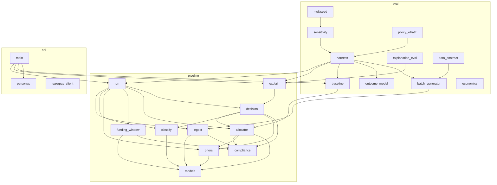
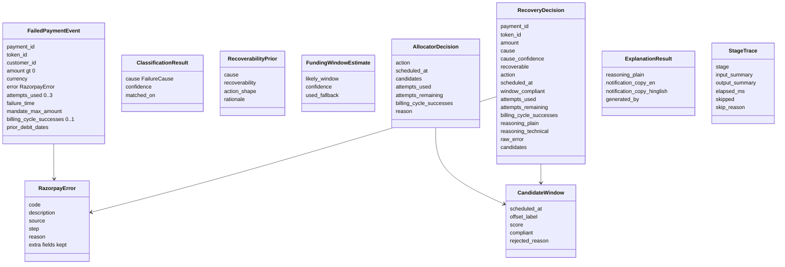
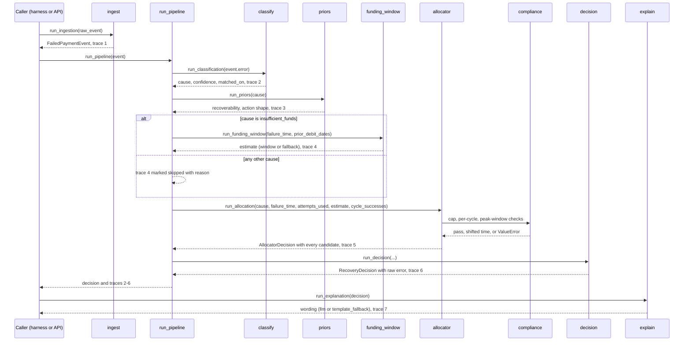
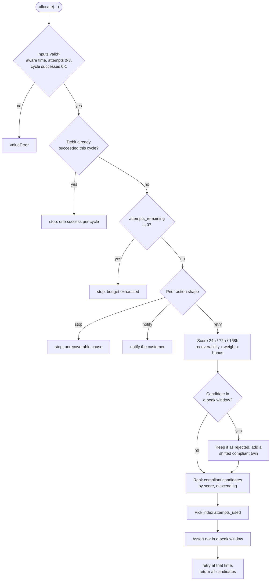
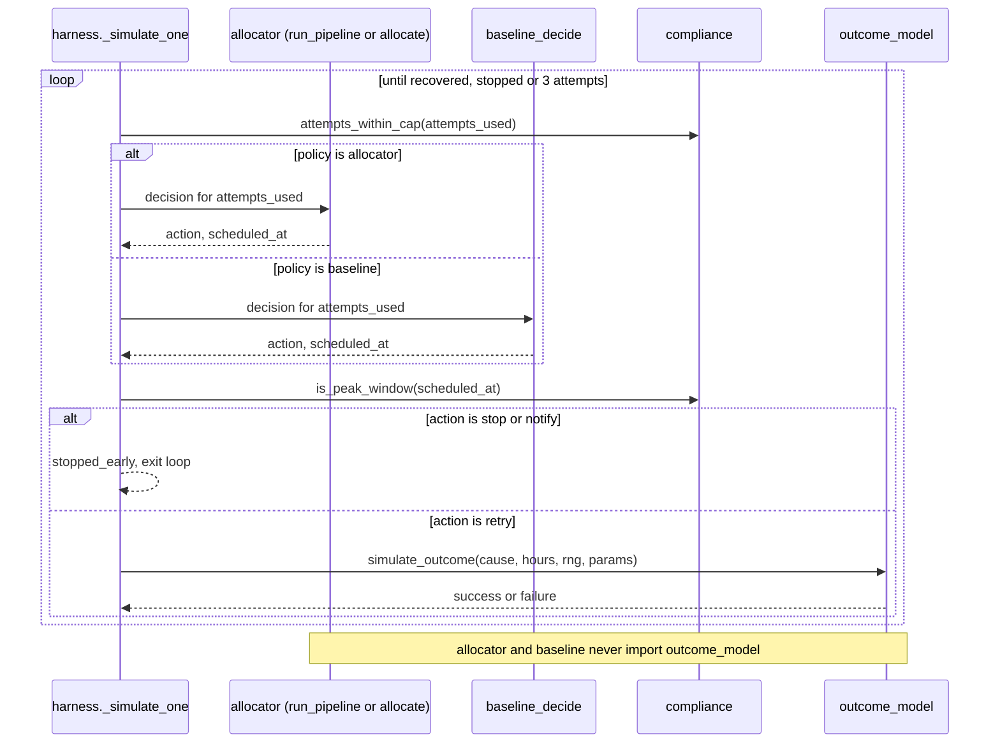
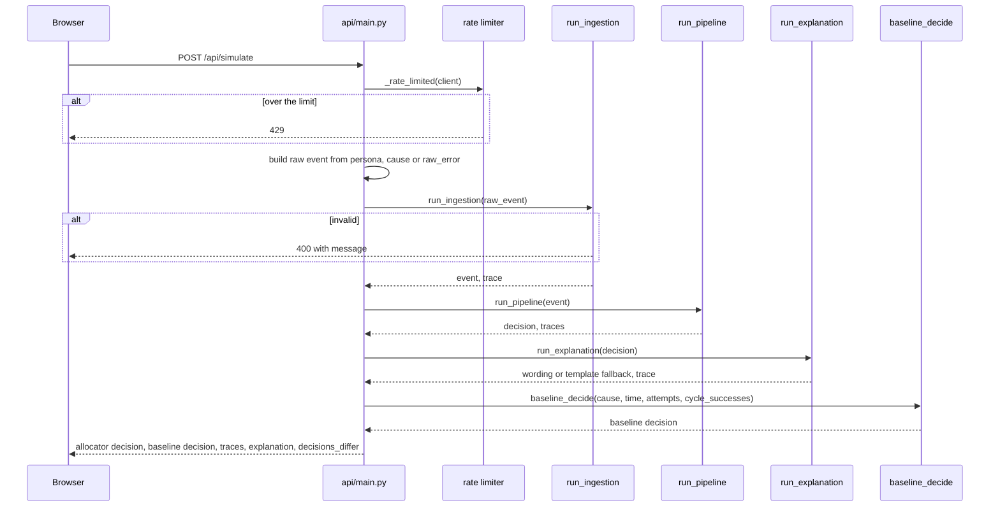
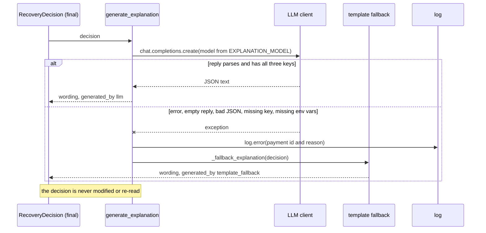

# Low-Level Design (LLD)

Detailed Low-Level Design of the Retry Budget Allocator: module by module,
the responsibilities, key functions and signatures, data models, algorithms,
error handling, trace and log formats, and how each stage is tested. "Sec N"
refers to [prd.md](prd.md). System-level view: [HLD.md](HLD.md). Pipeline and
compliance diagrams: [architecture.md](architecture.md). Numbers:
[RESULTS.md](RESULTS.md). Real errors and fixes: [errorlog.md](errorlog.md).

Contents: [1 Module map](#1-module-map-and-import-rules) -
[2 Data models](#2-data-models) - [3 pipeline/](#3-pipeline) -
[4 eval/](#4-eval) - [5 api/](#5-api) - [6 dashboard/src](#6-dashboardsrc) -
[7 Error handling](#7-error-handling) - [8 Trace and log formats](#8-trace-and-log-formats) -
[9 Test strategy](#9-test-strategy) - [10 Sequence diagrams](#10-sequence-diagrams)

## 1. Module map and import rules

Main dependencies (not every edge):



Import rules, all enforced by tests or CI rather than convention:

| Rule | Enforced by |
|---|---|
| `pipeline/` never imports `eval/outcome_model.py` (PRD Sec 5.1) | `tests/test_outcome_model_isolation.py` parses every `pipeline/*.py` with `ast` and fails on any import of `outcome_model` |
| `pipeline/` does not import `eval/` or `api/` at all | Same direction of dependency in the diagram above; `pipeline` has no import of either |
| `eval/economics.py` and the dashboard read saved aggregates, not the outcome model | `run_economics()` takes an already-computed `results_table` |
| `api/` never touches the outcome model | `api/main.py` imports `eval.baseline` only; a live run returns a decision, not a simulated outcome |
| Live network calls need an explicit flag | `LIVE_RAZORPAY=1` in `api/razorpay_client.py`; `LIVE_LLM=1` for `eval.explanation_eval --source llm` |

Conventions: type hints on every signature; Pydantic models for every record
that crosses a stage boundary; docstrings cite the PRD section; each stage has
a pure function and a `run_*` wrapper that returns `(result, StageTrace)`.

## 2. Data models

All in `pipeline/` unless noted. Money is an integer number of paise.



| Model | File | Notes |
|---|---|---|
| `FailureCause` (str Enum) | `models.py` | `insufficient_funds`, `mandate_revoked`, `mandate_expired`, `amount_exceeds_mandate`, `afa_required`, `bank_technical`, `unknown` |
| `Action` (Literal) | `models.py` | `"notify" \| "retry" \| "stop"`; shared by allocator, baseline and decision so it is declared once |
| `RazorpayError` | `models.py` | `extra="allow"`: only `code/description/source/step/reason` are typed, any other field Razorpay sends is kept, so the raw payload is never discarded |
| `FundingWindowEstimate` | `models.py` | `likely_window: tuple[datetime, datetime] \| None`, `confidence: float`, `used_fallback: bool` |
| `StageTrace` | `models.py` | One record per stage, see Section 8 |
| `FailedPaymentEvent` | `ingest.py` | Constraints: `amount` gt 0; `attempts_used` ge 0, le `MAX_RETRY_ATTEMPTS`; `billing_cycle_successes` ge 0, le 1; `mandate_max_amount` gt 0 when present |
| `ClassificationResult` | `classify.py` | `confidence` is rule-based, not statistical: 1.0 exact reason, 0.6 description keyword, 0.0 no match |
| `RecoverabilityPrior` | `priors.py` | `action_shape` is the Stage 3 recommendation the allocator obeys |
| `AllocatorPolicy` | `allocator.py` | `spacing_hours: tuple[int, ...]` (validated: exactly 3 strictly increasing positive offsets) and `confidence_threshold: float \| None`; defaults are the shipped policy; used by the what-if study |
| `CandidateWindow`, `AllocatorDecision` | `allocator.py` | `candidates` holds every scored window, rejected ones included |
| `RecoveryDecision` | `decision.py` | The audit record: action, time, all candidates, raw error, plain and technical reasoning |
| `ExplanationResult` | `explain.py` | `generated_by` is `"llm"` or `"template_fallback"` |
| `OutcomeModelParams` (frozen dataclass) | `eval/outcome_model.py` | The only parameters of the simulated world |
| `PaymentOutcome` (dataclass) | `eval/harness.py` | Per payment, per policy: attempts, recovered, amount, `stopped_early`, violations |
| `AttemptCostAssumptions` (frozen dataclass) | `eval/economics.py` | Gateway, notification and annoyance cost components |
| `SimulateRequest`, `SimulateResponse` | `api/main.py` | Request validation and the live response shape |

## 3. pipeline/

### 3.1 models.py - shared schemas and the tracing seam

Responsibility: shared types and `run_stage`, the single place stage timing
and trace creation happen (PRD Sec 6.1).

```python
def run_stage(stage: str, input_summary: str,
              fn: Callable[[], tuple[T, str]]) -> tuple[T, StageTrace]
```

`fn` returns `(result, output_summary)`; `run_stage` times it with
`time.perf_counter()` and wraps both in a `StageTrace`. Every `run_*` function
is a thin wrapper around a pure function plus this call, so tracing was built
in from Stage 1 rather than retrofitted.

### 3.2 compliance.py - the three invariants (PRD Sec 2, Sec 7 step 2)

Pure predicates with no dependency on the allocator, written and tested before
any allocation logic existed.

```python
MAX_RETRY_ATTEMPTS = 3
IST = ZoneInfo("Asia/Kolkata")
PEAK_WINDOWS = ((time(10, 0), time(13, 0)), (time(17, 0), time(21, 30)))  # [start, end)

def attempts_within_cap(attempts_used: int) -> bool          # 0 <= n <= 3
def is_peak_window(dt: datetime) -> bool
def at_most_one_success_per_cycle(successes_in_cycle: int) -> bool   # 0 <= n <= 1
def shift_out_of_peak(dt: datetime) -> datetime
```

- Peak windows are start-inclusive, end-exclusive, evaluated in IST after
  `dt.astimezone(IST)`. 10:00:00 is peak, 13:00:00 is not.
- `is_peak_window` raises `ValueError` for a naive datetime. Silently reading a
  naive datetime as IST would misclassify any UTC caller on a compliance path.
- `shift_out_of_peak` moves a peak time forward to the window's end boundary
  (13:00 or 21:30) and zeroes seconds and microseconds; non-peak times are
  returned unchanged (converted to IST).
- Callers: `allocator.allocate`, `eval.baseline.baseline_decide` (cap and
  per-cycle checks, peak assertion), `eval.harness` (post-hoc check of every
  scheduled attempt), `pipeline.decision` (the `window_compliant` flag).

### 3.3 ingest.py - Stage 1

```python
def ingest(raw_event: dict) -> FailedPaymentEvent
def run_ingestion(raw_event: dict) -> tuple[FailedPaymentEvent, StageTrace]
```

Pydantic validation is the work: a malformed event raises `ValidationError` at
the boundary instead of propagating bad data. The bounds on `attempts_used`
and `billing_cycle_successes` matter because `attempts_used` later indexes a
ranked list; before the 2026-09-14 fix a negative value silently wrapped around
to the worst candidate ([errorlog.md](errorlog.md)).

### 3.4 classify.py - Stage 2: deterministic cause lookup

```python
def classify_cause(error: RazorpayError) -> ClassificationResult
def run_classification(error: RazorpayError) -> tuple[ClassificationResult, StageTrace]
```

Algorithm (never a model call, by design):

1. `reason = (error.reason or "").strip().lower()`. If it is a key of
   `_REASON_TO_CAUSE`, return that cause with confidence 1.0 and
   `matched_on="reason:<reason>"`.
2. Otherwise lower-case `error.description` and scan `_DESCRIPTION_KEYWORDS` in
   order; the first keyword contained in the description wins, confidence 0.6,
   `matched_on="description_keyword:<kw>"`.
3. Otherwise `UNKNOWN`, confidence 0.0, `matched_on="no_match"`.

Reason table (`_REASON_TO_CAUSE`):

| Cause | Reasons |
|---|---|
| `insufficient_funds` | `insufficient_funds` |
| `bank_technical` | `bank_technical_error`, `gateway_technical_error`, `payment_timed_out`, `payment_declined`, `credit_failed`, `payment_collect_request_expired`, `vpa_resolution_failed` |
| `afa_required` | `authentication_failed`, `reqauth_mandate_not_acknowledged` |
| `mandate_revoked` | `token_cancelled`, `mandate_cancelled` (provisional) |
| `mandate_expired` | `token_expired`, `mandate_expired` (provisional) |
| `amount_exceeds_mandate` | `amount_exceeds_mandate`, `amount_limit_breached` (provisional) |

Keyword fallback, in order: `sufficient fund`, `mandate has been cancelled`,
`mandate cancelled`, `revoked`, `mandate has expired`, `mandate expired`,
`exceeds`, `additional factor`, `authentication`, `technical`, `downtime`.
Order matters because the first hit wins.

Scope decisions recorded in the source: mandate-registration failures and the
merchant-configuration error `recurring_payment_not_enabled` are outside the
taxonomy (there is no token to retry against); `invalid_vpa`, `payment_cancelled`
and `funds_blocked_by_mandate` are deliberately unmapped and fall through to
`unknown` and so to notify, the conservative default. The table was audited
against Razorpay's published error list on 2026-09-15 ([errorlog.md](errorlog.md)).

### 3.5 priors.py - Stage 3: recoverability and action shape

```python
def get_prior(cause: FailureCause) -> RecoverabilityPrior
def run_priors(cause: FailureCause) -> tuple[RecoverabilityPrior, StageTrace]
```

A fixed dictionary, one entry per cause:

| Cause | Recoverability | Action shape |
|---|---|---|
| `insufficient_funds` | 0.7 | retry |
| `bank_technical` | 0.6 | retry |
| `unknown` | 0.2 | notify |
| `afa_required` | 0.0 | notify |
| `mandate_revoked` | 0.0 | stop |
| `mandate_expired` | 0.0 | stop |
| `amount_exceeds_mandate` | 0.0 | stop |

These three action shapes are what make the system an intervention-chooser
rather than a scheduler: the shape is decided by cause before any timing is
considered. `RecoveryDecision.recoverable` is `recoverability > 0.0`.

### 3.6 funding_window.py - Stage 4: probabilistic funding window

```python
def estimate_funding_window(failure_time: datetime, prior_debit_dates: list[datetime],
                            confidence_threshold: float | None = None) -> FundingWindowEstimate
def run_funding_window(failure_time, prior_debit_dates,
                       confidence_threshold=None) -> tuple[FundingWindowEstimate, StageTrace]
```

It estimates a likely window; it never asserts that the funding date is known.

Algorithm, with `n = len(prior_debit_dates)` and a 30-day cycle:

1. If `n == 0`: `typical_day = 1` (a generic payday prior), `spread = 15`.
   Otherwise `observed_day = mean(day-of-month in IST)`,
   `spread = population stdev of days` (15 if `n == 1`),
   `prior_weight = 1/(n+1)`,
   `typical_day = (1 - prior_weight) * observed_day + prior_weight * 1`.
2. `consistency = max(0, 1 - spread/15)`, `volume = min(1, n/3)`,
   `confidence = round(consistency * volume, 4)`.
3. If `confidence < threshold`: return `likely_window=None`, `used_fallback=True`.
4. Otherwise `days_until = (typical_day - failure_day) % 30`,
   `center = failure_time + days_until days`,
   `half_width = max(0.5, spread/2)` days, and the window is
   `center +/- half_width`.

Consequences visible in the data: with fewer than 3 observations `volume < 1`
and `n <= 1` gives `consistency = 0`, so thin history yields confidence 0 or
close to it; with 3 or more consistent observations confidence is 0.87 or
higher. That near-binary distribution is why the threshold barely matters
([RESULTS.md](RESULTS.md) Section 10).

Threshold source: `FUNDING_CONFIDENCE_THRESHOLD` from `.env`; if unset or not a
float, `DEFAULT_CONFIDENCE_THRESHOLD = 0.5`. Declared simplification: the day of
month is averaged linearly, not circularly, so histories straddling a month
boundary look more scattered than they are; the fallback absorbs that.

### 3.7 allocator.py - Stage 5: scoring and the three-way choice

```python
def allocate(cause: FailureCause, failure_time: datetime, attempts_used: int,
             funding_estimate: FundingWindowEstimate | None = None,
             billing_cycle_successes: int = 0,
             policy: AllocatorPolicy = DEFAULT_POLICY) -> AllocatorDecision

def run_allocation(cause, failure_time, attempts_used, funding_estimate=None,
                   billing_cycle_successes=0) -> tuple[AllocatorDecision, StageTrace]
```

Constants: `_SAFE_SPACING_HOURS = (24, 72, 168)` (PRD Sec 2),
`_FUNDING_WINDOW_BONUS = 1.5`, and per-cause offset weights:

| Cause | 24h | 72h | 168h | Rationale |
|---|---|---|---|---|
| `bank_technical` | 1.0 | 0.5 | 0.25 | Monotonic: transient faults clear fast, so sooner scores higher |
| `insufficient_funds` | 0.7 | 1.0 | 0.45 | The 72h checkpoint is the no-information default; the other offsets are ranked by distance from it. The original weights contradicted this rationale and were corrected on 2026-09-04 |
| any other cause | 0.8 | 1.0 | 0.6 | Defined but unreachable today: other causes stop or notify before scoring |

The weights are a declared heuristic, not a probability. The real probability
lives in `eval/outcome_model.py`, which this module never imports.

**Decision order** (the first matching branch returns; later ones are not
evaluated):

1. Validate: naive `failure_time` raises `ValueError`; `attempts_used` outside
   0-3 raises `ValueError`; `billing_cycle_successes` outside 0-1 raises
   `ValueError`.
2. `billing_cycle_successes >= 1` returns `stop` ("a successful debit already
   occurred this billing cycle"), ahead of every other branch including a fresh
   budget.
3. `attempts_remaining = 3 - attempts_used`; if 0 returns `stop` ("retry budget
   exhausted").
4. Prior action shape `stop` returns `stop` with the prior's rationale.
5. Prior action shape `notify` returns `notify`.
6. Otherwise `retry`: score candidates, rank, pick.

**Scoring arithmetic.** For each offset `h` at position `i` in
`policy.spacing_hours`:

```
naive      = failure_time(IST) + h hours
weight     = _OFFSET_WEIGHTS[cause][_SAFE_SPACING_HOURS[i]]     # by position
score      = round(recoverability * weight * bonus, 4)
bonus      = 1.5 if estimate is not fallback and window_start <= t <= window_end else 1
```

Worked example from the shipped run (`pay_SYNTH00000`, `bank_technical`,
recoverability 0.6): 24h scores 0.6 x 1.0 = 0.6, 72h scores 0.6 x 0.5 = 0.3,
168h scores 0.6 x 0.25 = 0.15, so attempt 1 takes 24h (`chose 24h (score=0.6)`)
and attempt 2 takes 72h. For `pay_SYNTH00022` (`insufficient_funds`,
recoverability 0.7) a real funding-window estimate placed the 24h candidate
inside the window: 0.7 x 0.7 x 1.5 = 0.735, which beats the 72h candidate's
0.7 x 1.0 = 0.7, so the funding estimate re-ranked the offsets.

**Peak windows.** If `naive` is in a peak window the allocator records two
candidates: the original with `score=0.0`, `compliant=False`,
`rejected_reason="peak_window"`, and a twin labelled `"<h>h_shifted"` at
`shift_out_of_peak(naive)`, scored normally and compliant. Nothing is silently
dropped.

**Ranking.** `compliant = sorted(compliant candidates, key=score, reverse=True)`
(stable, so ties keep offset order) and the chosen window is
`compliant[attempts_used]`: attempt 1 gets the best window, attempt 2 the
next best, attempt 3 the third. Candidate generation does not depend on
`attempts_used`, so without this indexing a failed attempt would be retried at
the identical instant (the bug in [errorlog.md](errorlog.md), 2026-09-03). A
runtime `assert not is_peak_window(best.scheduled_at)` guards the result. The
returned `candidates` list is every scored window, winner and rejected alike
(PRD Sec 6.1), and `reason` is `chose <label> (score=<s>)`.

`run_allocation` does not take a policy: the shipped pipeline always uses the
default. Non-default policies are exercised only through the harness fast path.

One fact worth knowing: in the shipped 60-payment run no candidate is ever
rejected for a peak window. The generator draws off-peak failure times and the
default offsets are whole days, which preserve the time of day. The
peak-window branch is therefore proven by unit and property tests with
adversarial times and by the 12h offset in the what-if study, not by the
shipped batch.

### 3.8 decision.py - Stage 6: the decision record

```python
def assemble_decision(payment_id: str, token_id: str, amount: int, raw_error: RazorpayError,
                      classification: ClassificationResult, prior: RecoverabilityPrior,
                      allocation: AllocatorDecision,
                      explain_plain: Callable[[FailureCause, Action], str] = _template_reasoning_plain
                      ) -> RecoveryDecision
def run_decision(...same arguments...) -> tuple[RecoveryDecision, StageTrace]
```

- Carries `raw_error` and every candidate into the record (two hard
  constraints: nothing is discarded after classification, and not only the
  winner is kept).
- `window_compliant = scheduled_at is None or not is_peak_window(scheduled_at)`.
- `reasoning_technical` is built deterministically:
  `cause=<c> (confidence=<x>, matched_on=<m>); recoverability=<r>; action=<a>; <allocator reason>`.
- `reasoning_plain` comes from `explain_plain` (a template by default, the seam
  where wording can be swapped). When `billing_cycle_successes >= 1` a dedicated
  sentence is used instead, bypassing any hook, because that is a
  compliance-audit fact and the generic stop sentence would wrongly blame the
  mandate. The stop template puts plain words first and the term in brackets
  (presentation rule).

### 3.9 explain.py - Stage 7: the only model call

```python
def generate_explanation(decision: RecoveryDecision, client: OpenAI | None = None) -> ExplanationResult
def run_explanation(decision: RecoveryDecision, client: OpenAI | None = None
                    ) -> tuple[ExplanationResult, StageTrace]
```

Reads `LLM_BASE_URL`, `LLM_API_KEY` and `EXPLANATION_MODEL` from `.env`
(`_client()` raises `RuntimeError` naming whichever variables are missing).
It receives a finished `RecoveryDecision` and returns wording; nothing it
returns is read by any decision code.

Flow: build a client (injectable for tests) -> `chat.completions.create` with
a system prompt demanding a JSON object with `reasoning_plain`,
`notification_copy_en`, `notification_copy_hinglish`, `temperature=0.3`,
`max_tokens=1000` (reasoning-style free models spend tokens thinking before the
answer) -> reject empty content -> `_parse_json_response` strips a markdown
fence, parses JSON and requires all three keys to be non-empty strings ->
return `generated_by="llm"`.

Any exception (auth, rate limit, network, empty or truncated reply, bad JSON,
missing key, missing env vars) is caught, logged with the payment id by
`log.error(...)`, and `_fallback_explanation` returns the deterministic
templates with `generated_by="template_fallback"`. The prior-success case has
its own fallback sentence in both languages.

### 3.10 run.py - orchestrator for Stages 2-6

```python
def run_pipeline(event: FailedPaymentEvent,
                 explain_plain: Callable[[FailureCause, Action], str] = _template_reasoning_plain
                 ) -> tuple[RecoveryDecision, list[StageTrace]]
```

Runs classify, priors, funding window, allocate, decision and returns the five
traces in that order. Stage 4 runs only when the cause is `insufficient_funds`;
for every other cause `_run_funding_window_stage` returns a `StageTrace` with
`skipped=True` and a `skip_reason`, so the skip is visible rather than absent.
Ingest (Stage 1) and explain (Stage 7) traces are added by the caller: the
harness inserts ingest once per payment (not once per attempt) and appends
explain; the API prepends and appends them per request. Every payment's trace
list therefore shows all seven named stages, executed or skipped.

## 4. eval/

Nothing here is imported by `pipeline/`.

### 4.1 outcome_model.py - the frozen success model (PRD Sec 5.1)

```python
def success_probability(cause: FailureCause, hours_since_failure: float,
                        params: OutcomeModelParams = DEFAULT_PARAMS) -> float
def simulate_outcome(cause, hours_since_failure, rng: random.Random, params=DEFAULT_PARAMS) -> bool
def default_rng(params=DEFAULT_PARAMS) -> random.Random
```

| Cause | P(success) at `h` hours after failure |
|---|---|
| `mandate_revoked`, `mandate_expired`, `amount_exceeds_mandate`, `afa_required` | 0 |
| `unknown` | 0.05 (flat) |
| `bank_technical` | `0.8 x 0.5^(h / 36)` (initial probability 0.8, half-life 36 h) |
| `insufficient_funds` | `0.55 x exp(-0.5 x ((h/24 - 3.0) / 1.5)^2)` (Gaussian in days, peak 0.55 at day 3.0, spread 1.5) |

Check against the saved run: for `insufficient_funds` at 24h,
`0.55 x exp(-0.5 x (-2/1.5)^2) = 0.2261`, which is the reference probability
stored for that candidate. `OutcomeModelParams` is a frozen dataclass; the
sensitivity sweep varies `funding_event_day`, `funding_event_spread_days` and
`bank_technical_half_life_hours` with `dataclasses.replace`. It was written and
frozen before allocator scoring was tuned, and it is never edited to improve a
result. The allocator never sees it; the harness uses it to draw outcomes and to
annotate candidates with reference probabilities for display only.

### 4.2 baseline.py - the fixed-schedule comparator (PRD Sec 5)

```python
def baseline_decide(cause: FailureCause, failure_time: datetime, attempts_used: int,
                    billing_cycle_successes: int = 0) -> AllocatorDecision
```

Retries at day 1, 2, 3 (`_DAY_OFFSETS_HOURS = (24, 48, 72)`), ignoring cause.
It still obeys compliance so the comparison is fair: the same validation as
`allocate`, a stop when a debit already succeeded this cycle, a stop when the
budget is spent, a peak-window shift via `shift_out_of_peak`, and the same
runtime assert. It returns the same `AllocatorDecision` shape so the harness
scores both identically.

### 4.3 batch_generator.py - seeded, rule-compliant events (PRD Sec 5, Sec 5.0)

```python
def generate_batch(n: int, seed: int = 42) -> list[FailedPaymentEvent]
```

- Cause mix (a declared assumption, not observed): `insufficient_funds` 0.55,
  `bank_technical` 0.15, `mandate_revoked` 0.10, `afa_required` 0.08,
  `mandate_expired` 0.06, `amount_exceeds_mandate` 0.04, `unknown` 0.02.
- Failure time: `_BATCH_ANCHOR_TIME` (a fixed instant, 2026-09-01 12:00 IST)
  minus a random 0-30 days and 0-24 hours, redrawn until it is off-peak. A fixed
  anchor, not `datetime.now()`, is what makes the batch reproducible
  ([errorlog.md](errorlog.md), 2026-09-03).
- Amounts: round-rupee price points; AFA events above Rs 15,000; mandate caps of
  Rs 5,000, 10,000 or 15,000 (AFA events Rs 50,000); `amount_exceeds_mandate`
  events exceed their cap.
- Error payload: the matching fixture from `data/fixtures/`, verbatim.
- History for `insufficient_funds` only: 60% of events get 3-5 prior debits, one
  per calendar month, on a hidden "typical day" with +/-2 days of noise. Stage 4
  never sees the hidden day, only the noisy dates.

### 4.4 harness.py - batch runner (PRD Sec 5)

```python
def compute_batch_results(n: int, seed: int, outcome_params=DEFAULT_PARAMS,
                          include_details: bool = True,
                          allocator_policy: AllocatorPolicy = DEFAULT_POLICY
                          ) -> tuple[dict, list[dict]]            # pure, no file I/O
def run_batch(n: int = 60, seed: int = 42, outcome_params=DEFAULT_PARAMS) -> dict   # writes files
def _simulate_one(event, cause, policy, outcome_params, rng, include_details=True,
                  allocator_policy=DEFAULT_POLICY) -> tuple[PaymentOutcome, list[RecoveryDecision], list[list[StageTrace]]]
```

Per payment and per policy the loop is:

```
while True:
    if not attempts_within_cap(attempts_used): record violation; break
    decision = allocator (run_pipeline, or allocate() on the fast path) | baseline_decide
    if scheduled_at is in a peak window: record violation
    if action != "retry": stopped_early = action in (stop, notify) and attempts_used < 3; break
    hours = (scheduled_at - failure_time) in hours
    attempts_used += 1; attempts_spent += 1
    if simulate_outcome(cause, hours, rng, params): recovered = True; break
    if attempts_used >= 3: break
```

Each policy and payment gets its own RNG, `random.Random(f"{seed}-{payment_id}-{policy}")`,
so runs are reproducible and the policies do not share a random stream.
`include_details=False` is the sweep/multi-seed fast path: it calls `allocate()`
directly (Stage 4 is computed once per event) and skips decision records and
traces. A non-default `allocator_policy` with `include_details=True` raises
`ValueError` rather than being ignored.

Aggregation: `_aggregate` (attempts, recovered, rupees, attempts wasted on the
four structurally unrecoverable causes, violations, `stopped_early_count`),
`_per_cause_breakdown`, `_stop_decision_precision`, and
`_confidence_fallback_rate` (read from the Stage 4 traces).
`_attach_sample_explanations` calls Stage 7 for one representative payment per
cause and caches the result in the artifact; every other payment gets an
explicit skipped Stage 7 trace with a reason, so the LLM is bounded to a handful
of calls per run.

`run_batch` writes `eval/results/<run_id>.json`, `data/runs/<run_id>.json`
(git-ignored) and `logs/<run_id>.jsonl`, where `run_id` is a timestamp in IST.
The dashboard's committed copy is `dashboard/public/data/latest_run.json`.

### 4.5 Analysis modules

| Module | Entry points | What it does | Output |
|---|---|---|---|
| `sensitivity.py` | `run_sweep(n=60, seed=42, write_output=True) -> dict` | 3 x 3 x 3 grid over the outcome model; per row: both policies' aggregates, `attempts_saved`, `recovered_advantage`, `amount_advantage_paise`, `allocator_advantage_holds` (= `attempts_saved >= 0 and recovered_advantage >= 0`); `_confidence_analysis` shows classification confidence cannot explain the losses | `sensitivity.json` |
| `multiseed.py` | `run_multiseed(n, seeds)`, `run_multiseed_sweep(n, seeds)` | 10 pre-chosen seeds (42, 1, 2, 3, 7, 13, 99, 137, 500, 2026): recovered counts, mean and stdev; the full sweep per seed. `run_multiseed_sweep` calls `run_sweep(write_output=False)` so it cannot overwrite the canonical file | `multiseed.json`, `multiseed_sweep.json` |
| `economics.py` | `net_value_rupees`, `compute_breakeven`, `sweep_cost_per_attempt`, `compute_breakeven_surface`, `run_economics(results_table, assumptions)` | Net value = rupees recovered - attempts x cost; breakeven = delta rupees / delta attempts; a 6 x 5 surface over revocation risk and customer lifetime value. Reads aggregates only | `economics.json` |
| `policy_whatif.py` | `run_whatif()`, `evaluate_point(...)`, `confidence_distribution(...)` | 7 thresholds x 3 spacings x 10 seeds through `AllocatorPolicy`; defaults are not changed by what it finds | `policy_whatif.json` |
| `explanation_eval.py` | `run_eval(source, run_path)`; sources `template`, `cached`, `llm` | Eight deterministic checks over (decision, explanation); `llm` needs `LIVE_LLM=1` | `explanation_eval_<source>.json`, `logs/explanation_eval.jsonl` |
| `data_contract.py` | `run(n=5000, seed=42)`, `check(df)`, `main()` | Pandera schema with five rule checks over a generated batch; writes `docs/DATA_QUALITY.md` | `data_contract.json` |

`scripts/ci_eval_summary.py` reads the newest `eval/results/run_*.json` and
`data_contract.json`, writes a Markdown summary to the CI run page, and exits
non-zero if either policy has compliance violations, the allocator wasted
attempts on unrecoverable causes, or the data contract failed.

## 5. api/

### 5.1 main.py - FastAPI service

| Endpoint | Behaviour |
|---|---|
| `GET /api/personas` | Returns the five named scenarios |
| `POST /api/simulate` | Runs one payment through Stages 1-7 plus `baseline_decide`; returns both decisions, all stage traces, the explanation and `decisions_differ` |
| `POST /api/webhooks/razorpay` | Signed event recorder; appends to `logs/webhooks.jsonl` |

`simulate` flow: identify the client (first `X-Forwarded-For` entry, else the
socket host) -> `_rate_limited(client)` (sliding one-minute `deque` per client;
429 over `SIMULATE_RATE_LIMIT`, default 30) -> build the raw event from a
persona, a `cause` fixture or a pasted `raw_error` (precedence: persona, then
`raw_error`, then `cause`; none given is a 400) -> `run_ingestion` (a validation
failure becomes 400 with the message) -> `run_pipeline` -> `run_explanation` ->
`baseline_decide` -> response. `failure_time` is `datetime.now(IST)`, so the
live path's peak-window shift depends on the time of day the request arrives.

Request limits: `amount` 1 to 100,000,000 paise, `raw_error` at most 16,384
bytes when serialised, `attempts_used` 0-3, `billing_cycle_successes` 0-1,
`prior_debit_day_of_month` 1-28, `n_prior_debits` 0-24. FastAPI turns
violations into 422 with an array `detail`, which `dashboard/src/lib/simulate.js`
formats.

Webhook order of checks: secret configured (else 503) -> body size (else 413) ->
HMAC-SHA256 equals `X-Razorpay-Signature` via `hmac.compare_digest` (else 401)
-> body parses as JSON (else 400) -> append `{received_at, event, payload,
raw_body_length}` and return `{"status": "logged"}`.

CORS: `allow_origins` from `CORS_ORIGINS` (comma separated, default
`http://localhost:5173`). Logging: `logging.basicConfig` at INFO, logger `api`,
one `live simulate: ...` line per request.

### 5.2 personas.py

Five scenarios, each loading its error object from `data/fixtures/`: Priya
(`insufficient_funds`, consistent history, so a real funding window), Rahul
(`mandate_expired`, stop), Ananya (`bank_technical`, retry soon), Karan
(`afa_required`, notify) and Meera (`bank_technical` with
`billing_cycle_successes=1`, so both policies stop). Together they exercise all
three branches and the third compliance invariant on screen.

### 5.3 razorpay_client.py - opt-in live client

`create_customer`, `register_mandate`, `charge_token`, all calling
`_require_live_enabled()` first (raises `LiveRazorpayDisabled` unless
`LIVE_RAZORPAY=1`) and `_client()` (requires both credentials and a `rzp_test_`
key id). `register_mandate` creates a recurring-token order and then attempts the
authorization, returning the order, the authorization, or the captured exception
type and message, because callers need the real response either way. Used by
`scripts/live_mandate_probe.py`, not by the dashboard.

## 6. dashboard/src

React 19 + Vite + Tailwind 4 + Recharts. Static build; reads JSON from
`public/data/`. Only the Live Simulator calls the API.

| File | Role |
|---|---|
| `main.jsx`, `App.jsx` | Entry; hash routing between the landing page and eight tabs (Start here, Live Simulator, Story, Decision Trace, Batch Results, Evals, Audit Trail, Policy What-If). All hooks run before the landing-page early return (Rules of Hooks) |
| `lib/useRunData.js` | Fetches `latest_run.json` and `sensitivity.json`; exposes `{loading, error, run, sensitivity}` |
| `lib/useJson.js` | Fetches an optional artifact; a missing file is not fatal, the panel says what to run |
| `lib/simulate.js` | `fetchPersonas`, `runSimulation`, `toPaymentShape` (adapts the live response to the batch payment shape, with `allocator: null` because a live run has no simulated outcome); `API_BASE` from `VITE_API_BASE` |
| `lib/compliance.js` | JS port of the three invariants, run over every loaded decision (`runComplianceChecks`) so the claim is checked on screen |
| `lib/site.js`, `lib/format.js`, `lib/csv.js` | Shared copy (stages, interventions, glossary, doc links), plain-language labels and money formatting, CSV export for the audit trail |
| `components/HeroDiagram.jsx` | Click a failure reason, see which of the three interventions it routes to |
| `views/LandingPage.jsx`, `GuideView.jsx` | Thesis with its caveat; the Start here guide to one real payment and a map of every page |
| `components/Tour.jsx` | Docked app tour. Steps live in `lib/site.js` (`TOUR_STEPS`); it navigates by calling App's `goToPage`, and is rendered at one fixed position in App so it keeps its step when the view changes between the overview and the dashboard |
| `views/LiveSimulatorView.jsx` | Persona picker or custom input; calls the API; shows allocator versus baseline |
| `views/StoryView.jsx`, `DecisionTraceView.jsx` | Plain-language narrative; raw error beside its translation, per-stage timings, every candidate window with its score and reference probability |
| `views/BatchResultsView.jsx`, `ExplanationEvalPanel.jsx` | Both policies' totals, live compliance panel, per-cause table, 27-point sweep chart, explanation faithfulness |
| `views/EvalsView.jsx`, `AuditTrailView.jsx`, `WhatIfView.jsx` | Seed stability, break-even, data contract; filterable decision list with CSV export; allocator knobs from `policy_whatif.json` |

## 7. Error handling

| Where | Error | Handling |
|---|---|---|
| `FailedPaymentEvent` | Missing field, non-positive amount, `attempts_used` or `billing_cycle_successes` out of range | `pydantic.ValidationError` at Stage 1 |
| `allocate`, `baseline_decide` | Naive `failure_time`, out-of-range counters | `ValueError`, never a clamped or wrapped value |
| `allocate`, `baseline_decide` | A chosen time inside a peak window | `assert`; unreachable by construction |
| `is_peak_window` | Naive datetime | `ValueError` |
| `classify_cause` | Unrecognised reason and description | Not an error: `unknown`, confidence 0.0, action notify; raw payload retained |
| `AllocatorPolicy` | Not 3 strictly increasing positive offsets | `ValueError` from a field validator |
| `compute_batch_results` | Non-default policy with details on | `ValueError` |
| `generate_batch` | `n < 1` | `ValueError` |
| `explain.py` | Any exception in the LLM path | Caught, `log.error` with payment id and reason, template fallback |
| `api/main.py` | Bad input | 400 / 422 / 404 / 429 with a plain `detail` |
| `api/main.py` webhook | No secret, bad signature, too large, not JSON | 503 / 401 / 413 / 400 |
| `razorpay_client.py` | Flag off, credentials missing, non-test key | `LiveRazorpayDisabled` |
| `explanation_eval --source llm` | `LIVE_LLM` not set | `RuntimeError` |
| `latest_run_path()`, `scripts/ci_eval_summary.py` | No run artifact | `FileNotFoundError` / `SystemExit` naming the command to run |
| Dashboard hooks | Missing or failed fetch | Plain error message naming the file and the command that regenerates it |

There are no silent failures: each handler either raises with a message, logs
with context, or degrades to a documented deterministic fallback. The broad
`except Exception` in `explain.py` (and the probe capture inside
`razorpay_client.register_mandate`) are deliberate and annotated.

## 8. Trace and log formats

**Stage trace** (`StageTrace`, one per stage, stored in the run artifact under
`allocator_stage_traces` and returned by the API):

```json
{"stage": "funding_window",
 "input_summary": "cause=bank_technical",
 "output_summary": "not applicable",
 "elapsed_ms": 0.0,
 "skipped": true,
 "skip_reason": "funding-window inference only applies to insufficient_funds, not bank_technical"}
```

Stage names in order: `ingest`, `classify`, `priors`, `funding_window`,
`allocate`, `decision`, `explain`. In the shipped run each of the 60 payments
shows all seven; Stage 4 is skipped for 25 (the non-`insufficient_funds`
payments) and Stage 7 for 53 (all but the 7 sampled payments).

**Candidate window** (inside every decision): `{scheduled_at, offset_label, score, compliant, rejected_reason}`,
for example `{"offset_label": "24h", "score": 0.6, "compliant": true, "rejected_reason": null}`.
`allocator_candidate_reference_probabilities` stores the frozen model's
probability per label for display, e.g. `{"24h": 0.504, "72h": 0.2, "168h": 0.0315}`.

**Batch JSONL log** (`logs/<run_id>.jsonl`, written by `eval/harness.py`, one
JSON object per line, each carrying `run_id`):

| `event` | Fields |
|---|---|
| `batch_started` | `n`, `seed` |
| `allocator_decision` | `payment_id`, `cause`, `action`, `scheduled_at` (first decision per payment) |
| `compliance_violation` | `payment_id`, `detail` (none occur in a clean run) |
| `explanation_generated` | `payment_id`, `generated_by` |
| `batch_completed` | `results_table` |

Other JSONL logs: `logs/policy_whatif.jsonl` (`policy_whatif_completed`),
`logs/explanation_eval.jsonl` (`explanation_eval_completed` with pass rate and
failed checks), `logs/webhooks.jsonl` (signed webhook events).

**Python logging.** Loggers `pipeline.explain`, `eval.harness`,
`eval.sensitivity`, `eval.explanation_eval`, `eval.policy_whatif` and `api` use
the standard `logging` module (INFO by default in scripts and the API). The
LLM-failure line `LLM explanation failed for <payment_id>, falling back to
template: <reason>` goes to the console log, not to the JSONL file.

Honest limits of the logs: the JSONL records batch-level events, not
stage-entered/stage-completed lines (stage timing lives in the traces inside the
run artifact). `/logs/` is git-ignored in bulk; the one committed sample,
`logs/sample_run.jsonl`, comes from an earlier run (`run_20260904T223013`) and
contains no caught error, so it is evidence of format, not of a failure being
handled. The handled failures are documented in [errorlog.md](errorlog.md).

## 9. Test strategy

431 tests pass; coverage of `pipeline/` is 98% (`pytest --cov=pipeline
--cov-report=term`): 100% on `allocator`, `classify`, `compliance`, `decision`,
`ingest`, `models`, `priors` and `run`; 92% on `explain` and `funding_window`.
Every stage has its own test file, written with or before the stage.

| Unit | Test file (count) | What it asserts |
|---|---|---|
| Compliance | `test_compliance.py` (51) | Every minute-level boundary of both peak windows (start inclusive, end exclusive), attempt cap edges (3 ok, 4 not, negatives rejected), one-success edges, `shift_out_of_peak` lands exactly on the window end and clears microseconds, naive datetimes rejected, non-IST zones converted. Written before the allocator. Mutation testing (`mutmut`, weekly) targets this file |
| Stage 1 ingest | `test_ingest.py` (16), `test_ingest_fuzz.py` (5) | Valid parse, malformed rejected, bounds on amount, `attempts_used` and `billing_cycle_successes` at and beyond the edges, trace; Hypothesis fuzzing over a wide generated range |
| Stage 2 classify | `test_classify.py` (26), `test_classify_fuzz.py` (3), `test_fixtures.py` (8) | Each documented reason maps to its cause; keyword fallback order; unknown path; every fixture classifies as its filename claims; fuzzing never raises, confidence is always one of the three declared values, and unrecognised input never reads as permission to retry or as a terminal stop |
| Stage 3 priors | `test_priors.py` (15) | Every cause has a prior, recoverability in 0-1, the unrecoverable set is zero, AFA never silently retried |
| Stage 4 funding window | `test_funding_window.py` (7) | No history falls back; consistent history gives a window and high confidence; inconsistent history falls back; one observation is low confidence; confidence never exceeds 1; window lands after failure time |
| Stage 5 allocator | `test_allocator.py` (25), `test_allocator_fuzz.py` (6) | Stop and notify causes spend nothing; all candidates returned; exhausted budget stops across causes; a peak candidate is scored and rejected, not dropped; successive attempts pick distinct windows in descending score; funding window bonus raises a score; out-of-range counters fail loudly; a prior success stops regardless of cause. Fuzz: never a peak-window choice, never raises on valid input, unrecoverable causes never retry, out-of-range counters always fail loudly, a prior success never retries |
| Stage 6 decision | `test_decision.py` (5) | Raw error and all candidates carried; stop has no time and is compliant; custom explain hook used; prior-success sentence accurate |
| Stage 7 explain | `test_explain.py` (9) | LLM reply parsed, fenced JSON parsed, malformed JSON, missing key, empty string, client exception each fall back to the template; fallback deterministic; prior-success fallback does not blame the mandate. No test makes a network call; a stub client is injected |
| Orchestrator | `test_run.py` (6) | Five traces in order; Stage 4 runs with and without history and is marked not applicable otherwise; hook flows through; prior success stops end to end |
| Baseline | `test_baseline.py` (23) | Retries regardless of cause, fixed offsets, never stops early, exhausted budget stops, never in a peak window, same loud-failure guards |
| Outcome model | `test_outcome_model.py` (116), `test_outcome_model_isolation.py` (1) | Unrecoverable causes always 0; probabilities in 0-1; decay and Gaussian shape; seeded reproducibility. Isolation: AST scan of `pipeline/` |
| Batch generator | `test_batch_generator.py` (11) | Count and unique ids; reproducible; failure times anchored not wall-clock (with a real sleep between calls); amounts valid; first attempts off-peak; AFA above Rs 15,000; one debit per month |
| Harness | `test_harness.py` (11) | Zero violations for both policies; artifacts written; allocator wastes nothing on unrecoverable causes; reproducible; every payment shows all seven stages; one cached explanation per cause; raw error preserved in the artifact |
| Analysis | `test_sensitivity.py` (5), `test_multiseed.py` (7), `test_economics.py` (12), `test_policy_whatif.py` (12), `test_explanation_eval.py` (20), `test_data_contract.py` (5) | Grid completeness; zero violations at every grid point; multi-seed sweep does not overwrite the canonical file; breakeven matches a hand computation; default what-if point reproduces the shipped numbers; contract accepts good rows and rejects each kind of bad row |
| API | `test_api.py` (21), `test_razorpay_client.py` (5) | Each persona's behaviour, validation errors, rate limit, degraded explanation visible in the response, signed webhook (closed without a secret, bad signature, oversize); every live-client function refuses without the flag |

CI (`.github/workflows/`): `ci.yml` runs ruff, pytest with coverage, the data
contract, the eval harness and the eval gates, and the dashboard lint and build;
`quality.yml` runs vulture (dead code), xenon (complexity) and jscpd
(duplication); `codeql.yml` and `scorecard.yml` scan the code and supply chain;
`mutation.yml` runs weekly `mutmut` on `compliance.py` and tolerates at most one
survivor (a known equivalent mutant). `scripts/validate.sh` runs the same
checks locally with a pass/fail line per stage.

Not covered by tests, stated plainly: the Stage 7 live model path (by design,
see the 2026-09-03 entry in [errorlog.md](errorlog.md)), the dashboard (checked
by lint, build and manual browser runs rather than unit tests), and live
Razorpay behaviour (gated).

## 10. Sequence diagrams

### 10.1 One failed payment through the pipeline



### 10.2 The allocator's branch order



### 10.3 Batch simulation loop and the outcome model boundary



### 10.4 Live simulate request



### 10.5 Stage 7 failure and fallback


